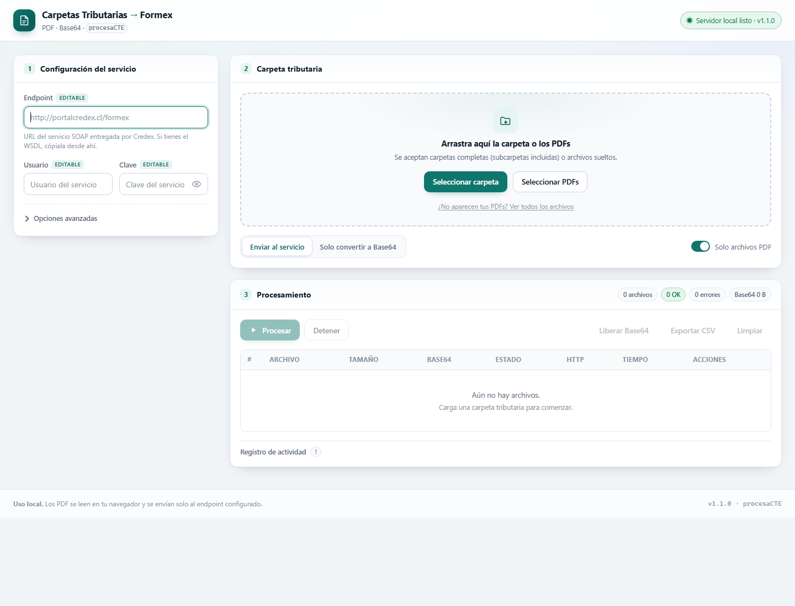
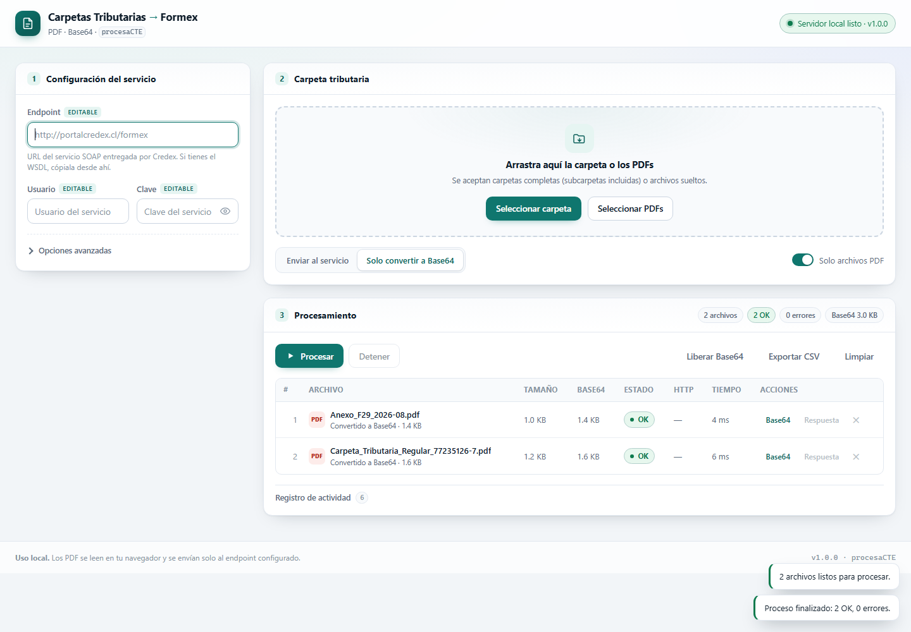
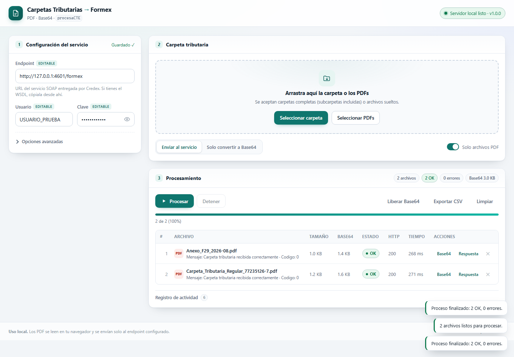
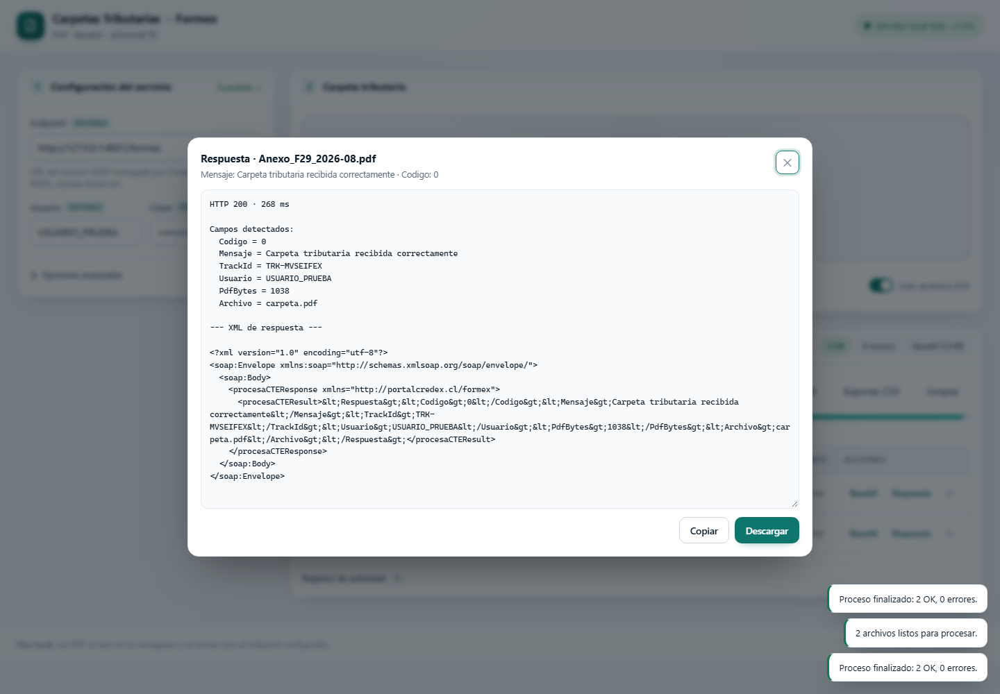
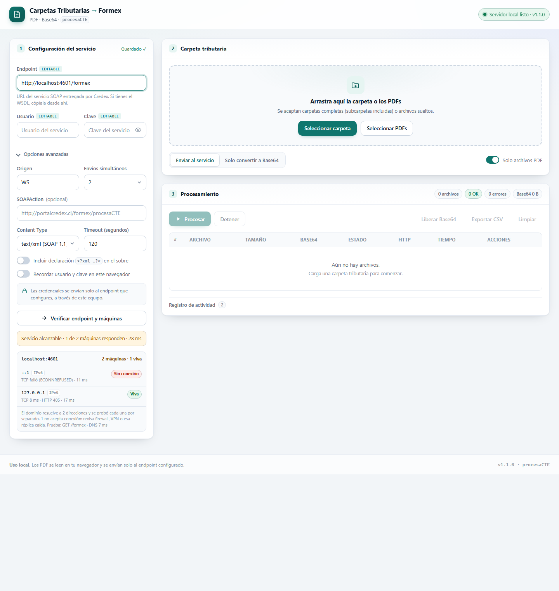

# Carpetas Tributarias → Formex

Aplicación web local que lee una **carpeta tributaria en PDF** (un archivo o una carpeta con varios), convierte cada documento a **Base64** y lo envía al servicio SOAP `procesaCTE` de Formex / Portal Credex, con **endpoint, usuario y clave editables** desde la pantalla.



## Qué hace

- Carga **carpetas completas** (con subcarpetas) o PDFs sueltos, arrastrando o con el selector.
- Convierte cada PDF a Base64 **sin prefijo `data:`** ni saltos de línea (codificación estándar).
- Arma el sobre SOAP con la estructura exacta del request entregado por Credex y lo envía al endpoint configurado.
- **Verifica el endpoint**: resuelve el DNS, detecta si hay varias máquinas detrás del dominio y prueba cada una (TCP, TLS y HTTP).
- Muestra por archivo: estado, HTTP, tiempo, mensaje del servicio y el XML de respuesta completo.
- Permite exportar un **CSV** con el reporte y descargar/copiar el Base64 o la respuesta de cada documento.

## Capturas

| Conversión a Base64 | Envío al servicio |
| --- | --- |
|  |  |

Con el botón **Respuesta** se ve el XML devuelto por el servicio y los campos interpretados:



## Requisitos

- Windows, macOS o Linux.
- **Node.js 18 o superior** (probado con Node 24). No requiere `npm install`: el proyecto no usa dependencias externas.

## Inicio rápido

1. Doble clic en **`INICIAR.bat`** (o `npm start` en una terminal).
2. Se abre `http://127.0.0.1:4599` en el navegador.
3. Completa **Endpoint**, **Usuario** y **Clave**.
4. Arrastra la carpeta tributaria o usa **Seleccionar carpeta**.
5. Presiona **Procesar**.

> Si el puerto 4599 está ocupado, el servidor prueba automáticamente los siguientes y muestra la URL en la consola.

### Carga de archivos

- **Seleccionar carpeta**: elige la carpeta completa; se leen también sus subcarpetas.
- **Seleccionar PDFs**: elige uno o varios `.pdf`; el diálogo filtra por esa extensión.
- **Ver todos los archivos**: enlace bajo los botones, para cuando el diálogo de Windows no muestra los PDFs (asociaciones de archivos corporativas). La aplicación filtra y valida igualmente.
- También puedes **arrastrar** la carpeta o los archivos sobre la zona.

### Endpoint

El valor debe ser la URL que entrega Credex para el servicio (suele aparecer en el WSDL como `soap:address location`). En el campo se muestra `http://portalcredex.cl/formex` solo como referencia: **reemplázalo por el endpoint real** de tu integración.

Si tienes el WSDL, puedes abrirlo en el navegador (`...?wsdl`) y buscar la etiqueta `soap:address location="..."`.

### Opciones avanzadas

| Opción | Para qué sirve |
| --- | --- |
| **Origen** | Valor del nodo `<for:Origen>`. Por defecto `WS`. |
| **Envíos simultáneos** | Cuántos PDFs se envían a la vez (1 = secuencial). |
| **SOAPAction** | Cabecera SOAP 1.1. Si el servicio la exige, usa `http://portalcredex.cl/formex/procesaCTE`. |
| **Content-Type** | `text/xml` (SOAP 1.1, por defecto) o `application/soap+xml` (SOAP 1.2). |
| **Timeout** | Segundos máximos de espera por envío. |
| **Incluir declaración** | Agrega `<?xml version="1.0" encoding="UTF-8"?>` al inicio del sobre. |
| **Recordar usuario y clave** | Guarda las credenciales en `localStorage` de este navegador. Desactivado, la clave no se persiste. |
| **Verificar endpoint y máquinas** | Diagnóstico del servicio: DNS, máquinas detectadas, TCP, TLS y HTTP de cada una. |

## Verificación del endpoint y máquinas

El botón **Verificar endpoint y máquinas** (dentro de *Opciones avanzadas*) hace un diagnóstico completo:

1. Resuelve el nombre del endpoint y lista **todas las direcciones** que devuelve el DNS (registros A y AAAA).
2. Prueba **cada máquina por separado**: conexión TCP, handshake TLS (con su certificado) y una petición `GET`, conservando el `Host` y el SNI del dominio original.
3. Muestra por máquina: estado, tiempos, código HTTP y el motivo cuando falla.

| Estado | Significado |
| --- | --- |
| **Viva** | Acepta TCP, responde HTTP (200, 405 o cualquier código) y el certificado es válido. |
| **TLS inválido** | Responde, pero el certificado no verifica (vencido, autofirmado o no coincide con el dominio). Se confirma reintentando sin validar el certificado. |
| **Sin HTTP** | Acepta conexión TCP pero no entrega respuesta HTTP (firewall de aplicación o servicio colgado). |
| **Sin conexión** | No acepta la conexión TCP (puerto cerrado, VPN o réplica caída). |

Así puedes comprobar si el servicio está vivo aunque una réplica esté caída, o si el dominio entrega varias máquinas (balanceo). La prueba hace **una sola petición `GET` por máquina** (hasta 16 direcciones) y **no envía credenciales ni documentos**. Un `405` en esta prueba es normal: el servicio SOAP solo acepta `POST`.



## Modos de trabajo

- **Enviar al servicio**: convierte a Base64 y hace el POST SOAP (requiere endpoint, usuario y clave).
- **Solo convertir a Base64**: no envía nada; deja los PDFs codificados para verlos, copiarlos o descargarlos.

## El request que se envía

La aplicación reproduce el request de Credex y solo reemplaza credenciales y Base64:

```xml
<soapenv:Envelope xmlns:soapenv="http://schemas.xmlsoap.org/soap/envelope/"
                  xmlns:for="http://portalcredex.cl/formex">
   <soapenv:Header/>
   <soapenv:Body>
      <for:procesaCTE>
         <for:Input>
            <for:Credenciales>
               <for:Usuario>...</for:Usuario>
               <for:Clave>...</for:Clave>
               <for:Origen>WS</for:Origen>
            </for:Credenciales>
            <for:PDFB64>JVBERi0xLjQK...</for:PDFB64>
         </for:Input>
      </for:procesaCTE>
   </soapenv:Body>
</soapenv:Envelope>
```

El sobre generado se comparó con el archivo `input_wsformex.txt`: es idéntico salvo credenciales, Base64 y espacios/comentarios.

## Arquitectura

```
Navegador (public/)                 Servidor local (server.js)          Servicio Credex
─────────────────────               ─────────────────────────           ────────────────
lee PDF → Base64  ──POST /api/enviar──▶  fetch al endpoint real  ──SOAP──▶  procesaCTE
                                 ◀── respuesta XML (JSON) ────
```

El navegador **nunca** llama directo al servicio: el servidor local hace de puente. Así se evitan los bloqueos **CORS** y los errores de certificado del navegador, y las credenciales no se exponen a otros orígenes.

```
carpetas-tributarias-formex/
├─ INICIAR.bat               Lanzador para Windows
├─ server.js                 Servidor local + proxy SOAP (sin dependencias)
├─ package.json
├─ public/
│  ├─ index.html             Interfaz
│  ├─ styles.css
│  ├─ app.js                 Carga, conversión, envío y reporte
│  ├─ envelope.js            Constructor del sobre SOAP
│  └─ base64.js              Codificación Base64 por trozos (archivos grandes)
├─ herramientas/
│  ├─ servicio-prueba.js     Servicio SOAP falso para probar sin credenciales
│  └─ generar-ejemplo.js     Genera los PDFs de ejemplo (sin datos reales)
├─ ejemplos/                 Carpeta tributaria de ejemplo
├─ capturas/                 Imágenes de la aplicación
└─ test/                     Pruebas automáticas
```

## Probar sin credenciales reales

En una terminal:

```bash
node herramientas/servicio-prueba.js
```

Luego en la aplicación:

- Endpoint: `http://127.0.0.1:4601/formex`
- Usuario: cualquiera · Clave: cualquiera
- Para ver un error: usa la clave `error`.

La carpeta `ejemplos/Carpeta Tributaria 77235126-7` contiene dos PDFs de ejemplo (sin datos reales) y un `.txt` que la aplicación omite.

## Privacidad y seguridad

- Los PDF se leen en tu equipo y se envían **solo** al endpoint que configures.
- El servidor escucha únicamente en `127.0.0.1` (no accesible desde la red).
- La clave solo se guarda si activas **Recordar usuario y clave**.
- Si el endpoint usa `http://` (sin TLS), usuario, clave y documentos viajan sin cifrado: la aplicación lo advierte.
- No subas carpetas reales a servicios de prueba.

## Problemas frecuentes

| Síntoma | Causa / solución |
| --- | --- |
| «No se pudo contactar el servidor local» | El proceso `node server.js` no está corriendo. Ejecuta `INICIAR.bat`. |
| El diálogo de «Seleccionar PDFs» no muestra los PDFs | Usa **Ver todos los archivos** (enlace bajo los botones) o **Seleccionar carpeta**. El filtro del diálogo depende de las asociaciones de Windows; la app valida los PDF igualmente. |
| `ECONNREFUSED` | Endpoint o puerto incorrectos, o el servicio está caído. |
| `ENOTFOUND` | Error de DNS: revisa la URL o la conexión. |
| Se agota el tiempo | Sube el **Timeout**; el servicio puede tardar en procesar carpetas grandes. |
| Certificado TLS inválido | Usa el certificado/CA correctos. Como último recurso: `NODE_EXTRA_CA_CERTS=ruta\ca.pem` o `NODE_TLS_REJECT_UNAUTHORIZED=0` (solo en desarrollo). |
| «1 de N máquinas responden» | Hay réplicas caídas, una ruta IPv6 sin salida o un firewall: revisa el estado de cada fila del diagnóstico. |
| Todas las máquinas «Sin conexión» | El puerto está cerrado, cambió el endpoint o falta VPN/red. |
| El servicio responde `faultstring` | Credenciales o formato rechazado: el mensaje se muestra en la fila y en «Respuesta». |
| HTTP 500 con Fault | Es una respuesta válida del servicio; revisa el detalle en **Respuesta**. |
| Muchos archivos, mucha memoria | Usa **Liberar Base64** o procesa por lotes; cada PDF ocupa ~1,33× su tamaño en Base64. |

## Pruebas

```bash
npm test
```

24 pruebas con `node:test`: estructura y escapado del sobre, Base64 (incluido un PDF de 3 MB), proxy SOAP (éxito, SOAP Fault, timeout, conexión rechazada), diagnóstico del endpoint (IP directa, dominio con varias direcciones, puerto cerrado y DNS inexistente), validaciones y servido de archivos.

Si el entorno bloquea procesos hijos, ejecuta en un solo proceso:

```bash
node --test-isolation=none --test test/envelope.test.js test/base64.test.js test/e2e.test.js
```
